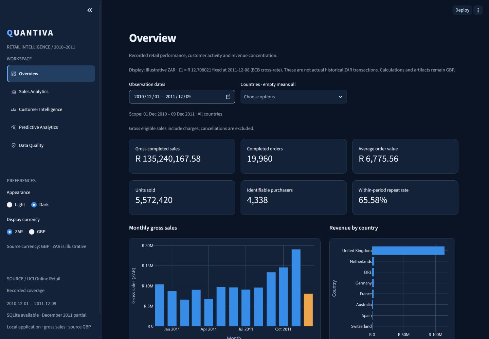
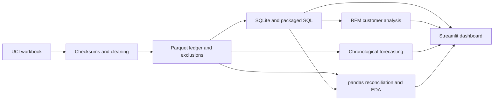

# Quantiva — Retail Intelligence & Predictive Analytics

Trace real retail transactions from an immutable source workbook to verified SQL
metrics, customer segments, evaluated forecasts and an interactive Streamlit dashboard.
Quantiva is a publicly accessible retail analytics and forecasting portfolio project.

**[Open the Live Dashboard](https://quantiva-dashboard.streamlit.app/)**

Explore the interactive dashboard without installing anything. For local analysis,
see [installation and reproduction instructions](#getting-started) below.

This is a **historical analytical dashboard**, not a live business intelligence feed.
Its five pages explore verified 2010–2011 transactions and a historical forecasting
demonstration; they do not report current sales or real-time exchange rates.

**Explore:** [Case study](reports/portfolio_case_study.md) ·
[Dashboard gallery](docs/dashboard_gallery.md) · [Architecture](docs/architecture.md) ·
[Reproduce the project](docs/reproducibility.md)

## Project overview

Retail reporting depends on decisions a revenue chart alone cannot explain: which
transactions qualify, how anonymous purchases affect customer analysis, whether
spikes are errors, and whether a forecast beats a simple baseline. Quantiva makes
those decisions explicit using one UK retailer's 2010–2011 records.

The project investigates where recorded sales concentrate, how identifiable customers
purchase and how reliably seven-day sales can be forecast. It demonstrates analytical
engineering and communication through a publicly hosted interactive demonstration.
No commercial adoption or measured revenue uplift is claimed.

## Key capabilities

- Checksums, deterministic cleaning, exclusions and source-row lineage.
- Rebuildable SQLite schema and 14 SQL analyses using joins, CTEs and window functions.
- SQL/pandas reconciliation, exploratory notebooks and descriptive statistics.
- Transparent Recency, Frequency, Monetary (RFM) customer segmentation.
- Naive, weekly seasonal naive, Linear Regression and Random Forest comparisons
  using chronological validation and recursive seven-day forecasts.
- Five dashboard pages, dark/light themes, filters and GBP/illustrative ZAR display,
  with original GBP calculations preserved.

## Dashboard preview



Real application capture using verified UCI data. ZAR is illustrative display currency,
not historical ZAR transaction revenue. The [six-view gallery](docs/dashboard_gallery.md)
includes light appearance and each analytical page.

| Page | What a reviewer can explore |
| --- | --- |
| Overview | Gross sales, orders, AOV, units, identifiable purchasers and concentration |
| Sales Analytics | Daily/weekly/monthly activity, products, countries and complete-month growth |
| Customer Intelligence | Purchase frequency, spend, RFM segments and log/linear plots |
| Predictive Analytics | Historical inference, validation/test comparisons, errors and limitations |
| Data Quality | Source/ledger counts, exclusions, missingness, calendar coverage and provenance |

Dates/countries filter the first three pages. Sales adds product-code filtering;
its AOV then measures selected lines per affected invoice, not full baskets.
Segment selection affects RFM charts/tables; customer KPI cards retain their
labeled date/country scope. Predictive Analytics and Data Quality use fixed full-data evidence.

## Key analytical findings

Historical dataset measurements cover 1 December 2010–9 December 2011, with a
partial final day/month, under the documented eligibility policy.

| Metric | Verified result |
| --- | ---: |
| Gross eligible completed-sales revenue | £10,642,110.80 |
| Completed orders | 19,960 |
| Average order value | £533.17 |
| Units sold | 5,572,420 |
| Identifiable purchasers | 4,338 |
| Within-period repeat purchasers | 2,845 |
| Within-period repeat rate | 65.58% |

Gross sales include anonymous purchases and eligible charges/postage. They are not
profit, settled payments or accounting net revenue. Mean order value exceeds the
£303.30 median, showing the influence of bulk orders. The UK contributes 84.59% of
recorded revenue; this describes the retailer, not national demand.
See [findings](reports/findings.md) and [KPI definitions](reports/kpi_specification.md).

| Model | Validation MAE (GBP/day) | Held-out MAE (GBP/day) |
| --- | ---: | ---: |
| Naive | 24,181.77 | 20,978.67 |
| Weekly Seasonal Naive | 15,580.52 | 11,250.17 |
| Linear Regression | 12,792.97 | Not evaluated |
| Random Forest | 11,431.53 | 12,344.71 |

Random Forest wins validation; **Weekly Seasonal Naive performs better on the
held-out test**. Selection remains frozen; no general machine learning superiority
is claimed. Inference for 9–15 December 2011 is a historical demonstration without
calibrated prediction intervals. [Model evaluation](reports/model_evaluation.md)
explains the chronology, recursive strategy and limits of historical tuning provenance.

## Technical architecture



Source data and models are regenerated locally; lightweight reports and figures
provide reviewable evidence. [Architecture](docs/architecture.md) maps the modules,
storage and presentation boundaries.

## Technology stack and repository structure

Python 3.11; pandas, NumPy, openpyxl, requests and PyArrow; SQLite and SQLAlchemy;
scikit-learn, SciPy and joblib; Matplotlib, Plotly and Streamlit; Jupyter tooling;
pytest, Ruff and GitHub Actions. The [lock](requirements-lock.txt) records the tested
Windows environment.

```text
app/                 Streamlit entry point
src/quantiva/        Ingestion, analytics, SQL, RFM, forecasting and dashboard services
notebooks/           Exploration, statistics and forecasting experiments
reports/             Measured findings, evaluation, figures and verification evidence
docs/                Architecture, reproduction and portfolio materials
scripts/             Data, forecasting, dashboard and documentation verification
tests/               Automated fixtures, regressions and Streamlit tests
data/                Ignored raw, processed and model artifacts; regenerate locally
```

## Getting started

To reproduce the analysis or run the dashboard locally, use the checkout root in
Windows PowerShell with Git and Python **3.11**:

```powershell
git clone https://github.com/InfinitelyAimz/quantiva.git
cd quantiva
py -3.11 -m venv .venv
.\.venv\Scripts\python.exe -m pip install -r requirements-lock.txt
.\.venv\Scripts\python.exe -m pip install --no-deps --no-build-isolation -e .
.\.venv\Scripts\quantiva.exe download
.\.venv\Scripts\quantiva.exe inspect
.\.venv\Scripts\quantiva.exe prepare
.\.venv\Scripts\quantiva.exe database
.\.venv\Scripts\quantiva.exe analyze
.\.venv\Scripts\quantiva.exe forecast-train
```

No activation is needed. Existing environments must also install the current lock;
an older environment may lack Streamlit or model dependencies. Generating the data
and models takes longer than starting the prepared app. These commands replace
derived outputs: use a separate checkout to preserve historical report evidence.

### Running the dashboard

```powershell
.\.venv\Scripts\python.exe -m streamlit run app/Home.py
```

Open the localhost URL printed by Streamlit. No account, API key or cloud service
is needed. The sidebar defaults to **illustrative ZAR**, with GBP available throughout.
The fixed ECB cross-rate is **1 GBP = 12.708021 ZAR on 8 December 2011**. Currency
and appearance persist within the session. Calculations, RFM scoring, evaluation
and stored artifacts remain GBP; only monetary presentation and exports convert.

On macOS/Linux use `python3.11 -m venv .venv` and `.venv/bin/python` /
`.venv/bin/quantiva`; this is guidance, not a claim of platform testing.
The full [reproducibility guide](docs/reproducibility.md) covers manual download,
checksums, stage prerequisites, SQL commands, notebooks, outputs and troubleshooting.

## Testing and verification

```powershell
.\.venv\Scripts\python.exe -m pytest -W error
.\.venv\Scripts\ruff.exe check .
.\.venv\Scripts\ruff.exe format --check .
.\.venv\Scripts\python.exe -m pip check
.\.venv\Scripts\python.exe scripts/verify_data.py
.\.venv\Scripts\python.exe scripts/verify_analytics.py
.\.venv\Scripts\python.exe scripts/verify_forecasting.py
.\.venv\Scripts\python.exe scripts/verify_dashboard.py
.\.venv\Scripts\python.exe scripts/verify_portfolio.py
```

The suite has **105 tests**. Actual-data checks cover seven data-integrity conditions,
3,982 SQL/pandas comparisons, 30 forecasting conditions and 63 dashboard conditions.
CI runs fixtures, lint, formatting and portfolio checks without the workbook; it does not
substitute for full-data or browser checks. Report-writing commands are identified
in the reproduction guide. [Phase 5 verification](reports/phase_5_progress.md)
records this delivery's results.

## Data source, methodology and limitations

Chen, D. (2015). *Online Retail*. UCI Machine Learning Repository.
[Dataset](https://archive.ics.uci.edu/dataset/352/online+retail),
[DOI 10.24432/C5BW33](https://doi.org/10.24432/C5BW33),
[CC BY 4.0](https://creativecommons.org/licenses/by/4.0/).

The workbook has 541,909 lines; 536,639 remain in the ledger after explicit duplicate
exclusions and quarantines. Missing IDs limit customer analysis. Duplicate rows are
ambiguous; cancellation movements are not matched physical returns. Missing dates
mean zero recorded sales, not proven zero demand. One retailer over roughly one year
cannot establish robust annual seasonality, causality or broad retail generalization.
ZAR is not transaction-date conversion.

The [methodology index](docs/methodology.md) connects the detailed Phase 1–4 decisions,
data-quality evidence, metric definitions and forecasting qualifications.

## Future improvements

Archive immutable pretest experiments; evaluate direct horizon models and calibrated
intervals on new data; investigate gap causes and curated charge codes; extend
accessibility/device checks. Production adaptation needs access controls, batch
identities, monitoring and operational ownership. These are future options, not
completed features or guaranteed accuracy gains.

## Author and project purpose

Developed by [InfinitelyAimz](https://github.com/InfinitelyAimz) as a retail analytics
portfolio demonstrating traceable engineering, defensible analysis and honest
model comparison.

Public technical guidance: [scope and verification contract](docs/technical_scope.md),
[architecture](docs/architecture.md), [reproduction](docs/reproducibility.md),
[methodology](docs/methodology.md) and [dashboard gallery](docs/dashboard_gallery.md).
These documents describe the implemented system, its measured results and its limits.

Technical milestone evidence: [data foundation](reports/phase_1_progress.md),
[SQL analytics](reports/phase_2_progress.md), [forecasting](reports/phase_3_progress.md),
[dashboard](reports/phase_4_progress.md) and [portfolio verification](reports/phase_5_progress.md).
