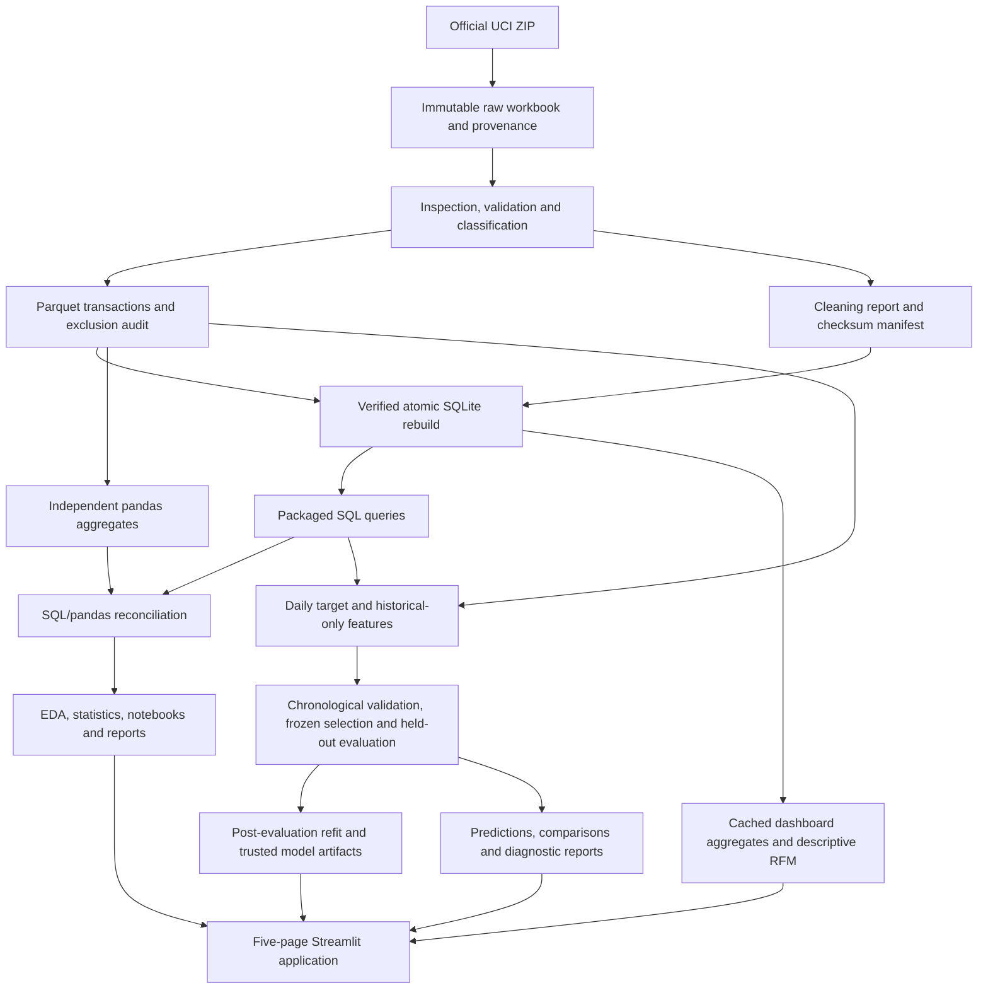

# Architecture

[README](../README.md) · [Reproduction](reproducibility.md) · [Methodology](methodology.md)

Quantiva is a local Python package with a CLI, executable notebooks and a Streamlit
presentation layer. SQLite is a rebuildable projection of a verified Parquet ledger.
No server database, external inference API or cloud deployment is part of the system.

## Module responsibilities

All paths below are relative to [src/quantiva](../src/quantiva).

| Modules | Responsibility |
| --- | --- |
| `config.py`, `cli.py` | Central paths and explicit stage orchestration |
| `ingestion.py`, `inspection.py` | Official download, immutable workbook, checksums and schema/quality inspection |
| `cleaning.py`, `pipeline.py` | Deterministic policy, original source-row traceability, exclusions, Parquet and manifests |
| `database.py`, `sql/` | Relational projection, constraints, indexes, eligible-sales view and 14 packaged queries |
| `analytics.py`, `reconciliation.py`, `analysis_report.py` | Independent aggregate calculations, reconciliation, statistics and report generation |
| `forecast_series.py`, `features.py` | Verified daily target, boundary/calendar policy and past-only predictors |
| `forecasting.py`, `forecast_evaluation.py` | Model fitting, recursive inference, date splits, rolling origins and metrics |
| `forecast_experiment.py`, `forecast_report.py`, `model_artifacts.py` | Validation selection, fixed experiment, evidence publication and trusted artifact loading |
| `segmentation.py` | Tie-aware, scope-relative RFM scoring and first-match segment rules |
| `dashboard/data.py`, `dashboard/evidence.py` | Parameterized aggregates, database-signature caches and checked forecast evidence |
| `dashboard/pages.py`, `dashboard/components.py`, `dashboard/currency.py`, `dashboard/presentation.py`, `dashboard/theme.py` | Five views, filters/state, display conversion, readable tables/charts and theme tokens |

[app/Home.py](../app/Home.py) owns navigation, persistent appearance/currency controls
and expected-failure guidance. It delegates page rendering to the dashboard package.

## Storage and integrity boundaries

| Location | Contents | Git policy |
| --- | --- | --- |
| `data/raw/` | Original workbook and download provenance | Ignored; recreate from UCI |
| `data/processed/` | Inspection, ledger, exclusion audit, manifest and SQLite | Ignored; rebuild from verified source |
| `data/processed/forecasting/` | Daily target, frozen selection and latest inference | Ignored; regenerate locally |
| `data/models/` | Model/preprocessing, context, metadata and checksums | Ignored; trust only locally generated artifacts |
| `reports/` | Small measured CSV/JSON evidence, methodology, PNG figures | Tracked; generated HTML is ignored |
| `notebooks/` | Executed exploration, statistics and forecasting notebooks | Tracked; rerunning updates outputs |

Raw records partition into ledger, duplicate exclusions and quarantines. Nullable
customer IDs remain missing; anonymous purchases still count toward aggregate sales.
SQLite stores prices/revenue as integer £0.0001 units, with foreign keys and integrity
checks. A validated sibling database atomically replaces the previous database;
preparation's separate output files are not one multi-file transaction. Concurrent
rebuild/read or model replacement is unsupported. SQLite byte layout can vary even
when its logical rows/schema are identical.

Forecast evaluation separates the pretest model from the later full-history refit.
During each seven-day window, predictions supply unavailable future lag context;
actual observations update context only between completed windows. Checksums establish
artifact consistency, not authenticity of an untrusted serialized Python object.

## Dashboard boundary

The app reads aggregates and saved evidence; it does not train models on navigation.
Database path, modification time, size and WAL signatures invalidate cached scopes.
RFM scores are computed in GBP before conversion. Currency helpers copy monetary
columns for display/CSV export; counts, scores, evaluation and source artifacts remain
unchanged. The default ZAR display is explicitly illustrative.

The system is designed for a finite local portfolio dataset. Production ingestion,
authentication, monitoring, service deployment and concurrent artifact versioning
would require additional design and independent validation.
