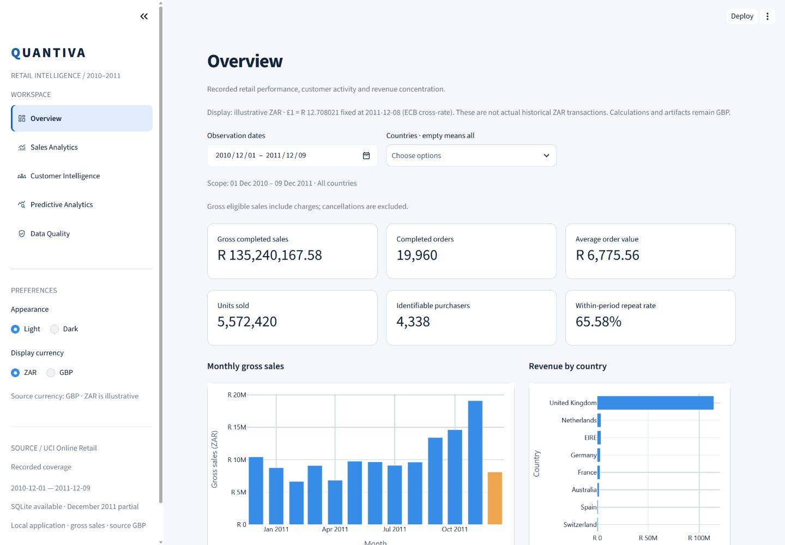
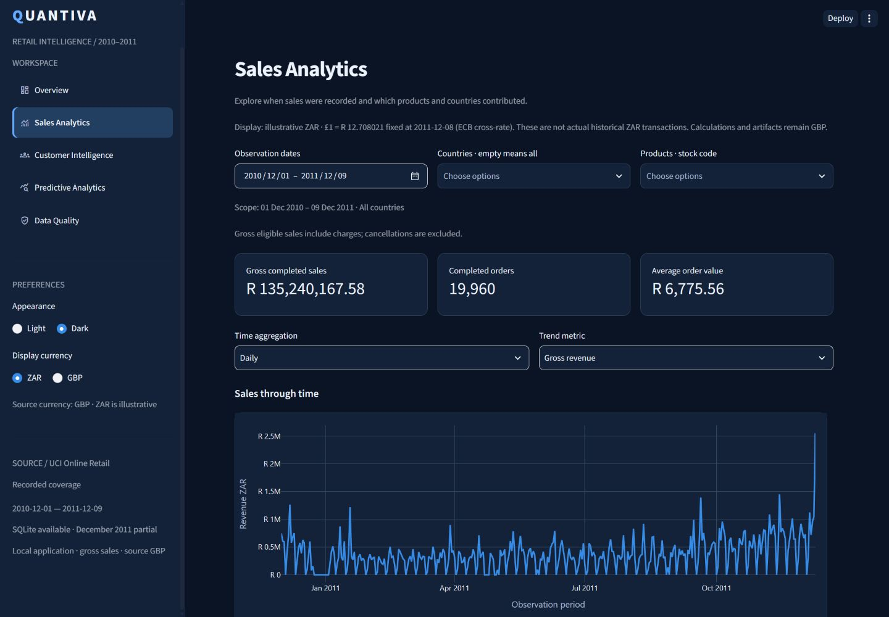
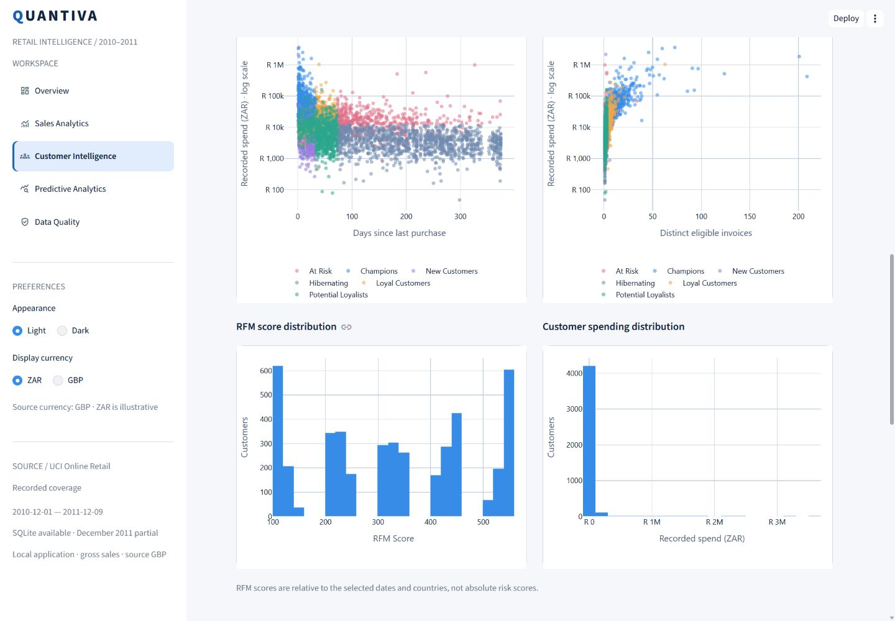
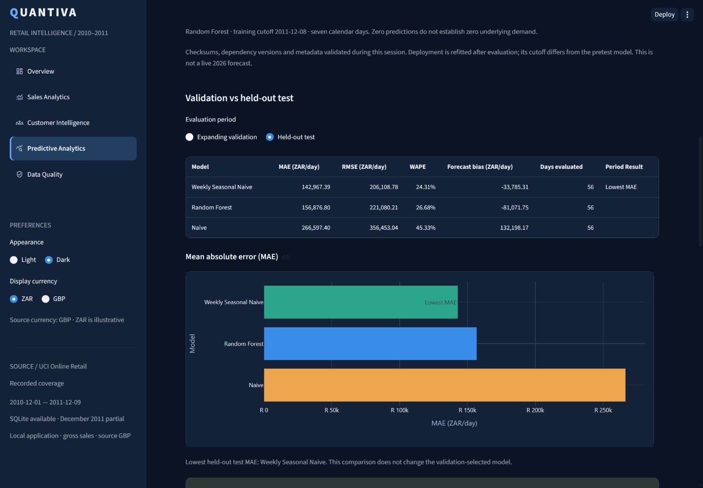
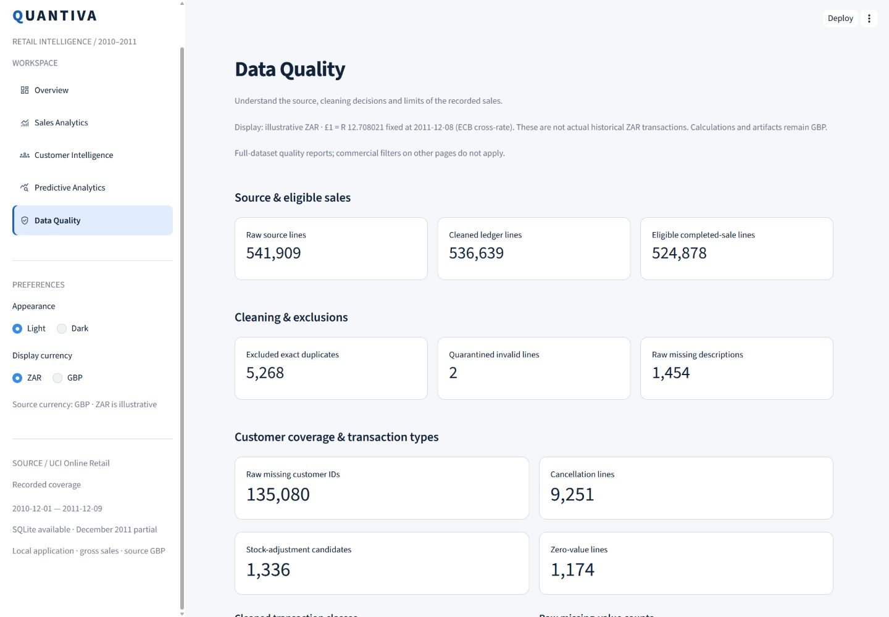

# Dashboard gallery

[README](../README.md) · [Case study](../reports/portfolio_case_study.md)

These six real Streamlit captures are reused from the accepted Phase 4 UI refinement
at `63cb56d3e214d19b151b3cd6080f034a2372b131`. Existing images remain in
`reports/figures`; Phase 5 adds no image copies. Each is 1440 × 1000 pixels. They are
viewport captures; more charts and explanations are available by scrolling in the app.
The captures contain public dataset aggregates, not private customer contact details.
Historical `.png` filenames are preserved; these captures contain JPEG-encoded image
bytes. They decode correctly and are reused without conversion or duplication.

All six show **illustrative ZAR**, using the fixed 8 December 2011 cross-rate
£1 = R12.708021. GBP source calculations and evaluation remain authoritative.
For other currency/mobile views see [Phase 4 UI verification](../reports/phase_4_ui_verification.md).

## Overview — dark

Full-scope KPIs and revenue concentration; the orange monthly bar flags partial
December coverage. Values are historical observed gross eligible sales.

## Overview — light

The same scope and amounts in the alternate appearance; theme changes do not change data.

## Sales Analytics

Date, country and product controls expose the selected analytical scope. The trend
shows recorded activity, not proven demand on dates without records.

## Customer Intelligence

Purchasing patterns use stable segment colors. The log
axis improves visibility across spending scales without dropping high-value customers.
RFM remains descriptive and relative to the selected scope.

## Predictive Analytics

The selected period is **Held-out test**. Weekly Seasonal Naive has the lowest MAE;
Random Forest remains validation-selected. Display conversion preserves model ranking.
This is historical evaluation, not a current business forecast.

## Data Quality

Separate source, ledger and eligible-line counts make exclusions and missingness
visible. These full-data quality counts are independent of commercial filters.

## Verification context

The [UI report](../reports/phase_4_ui_verification.md) and
[recorded browser states](../reports/phase_4_polish_browser_checks.json) describe
page/theme/viewport coverage. The final pre-merge acceptance audit additionally
checked all five pages with both currencies/themes at 600px and 1280px, 105 tests
and unchanged analytical artifacts. These are scoped observations, not formal
WCAG certification or universal device/browser guarantees.
