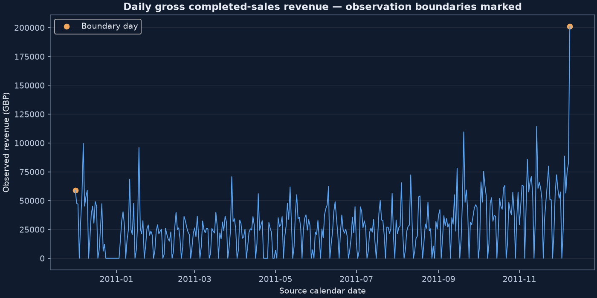
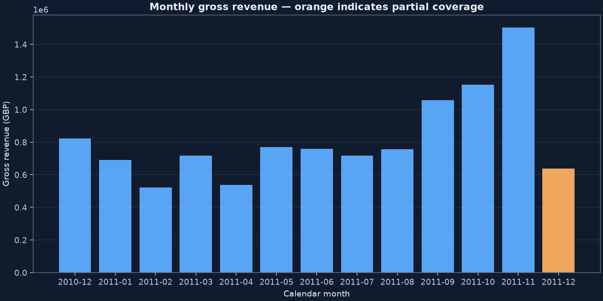
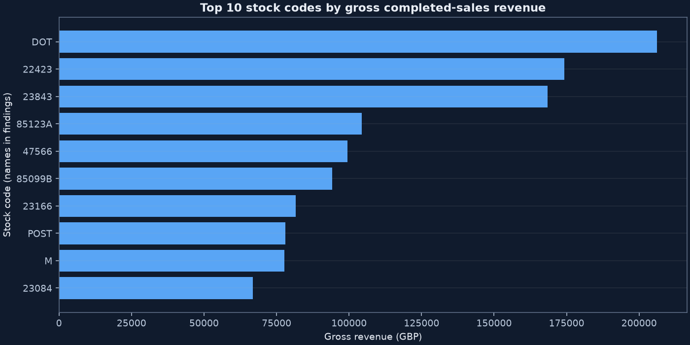
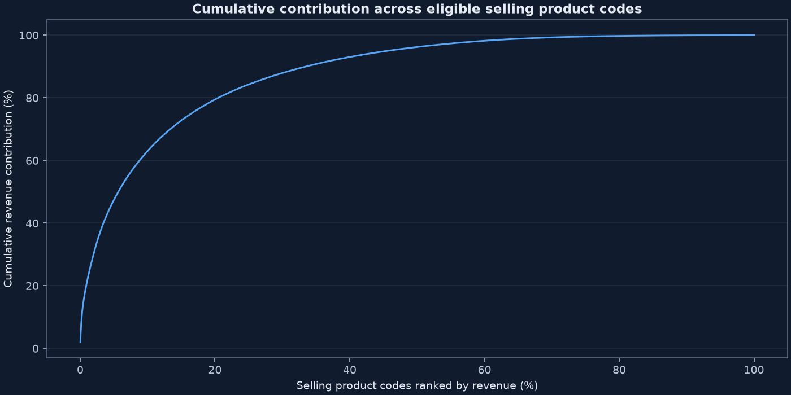
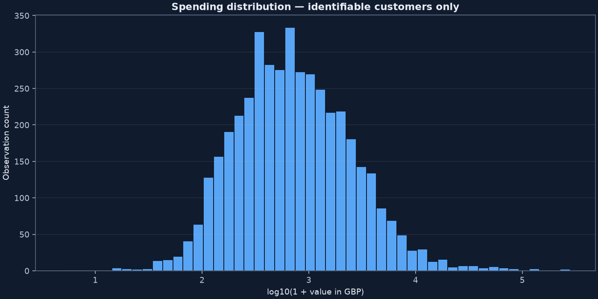
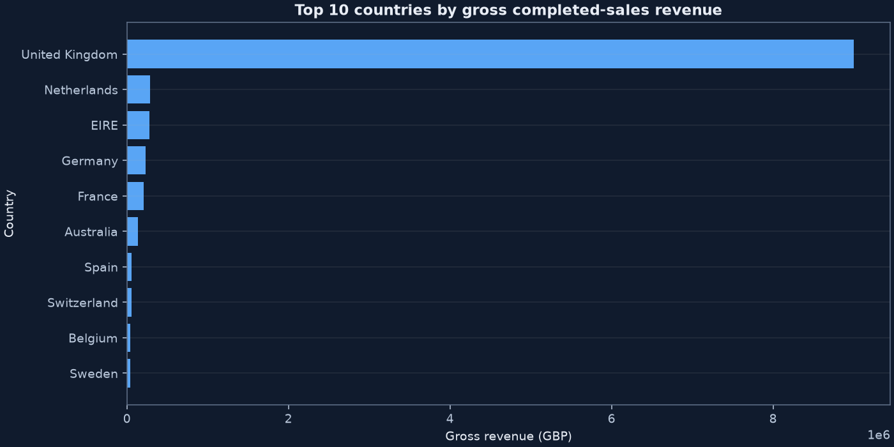
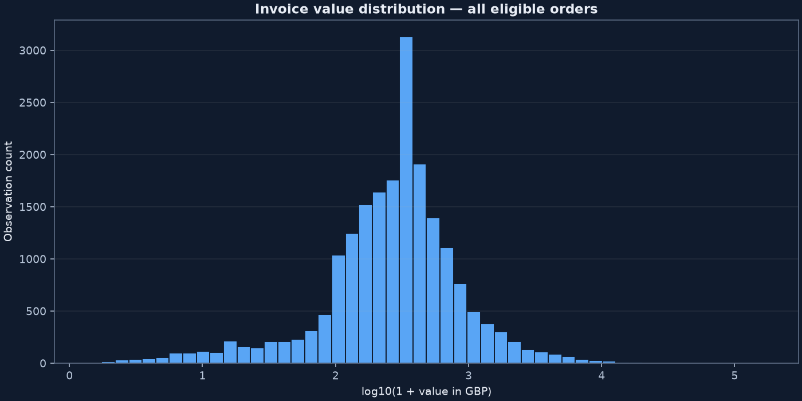
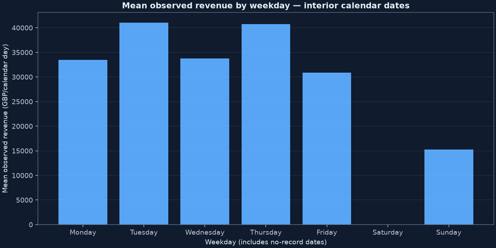

# Phase 2 — measured analytical findings

Generated by `quantiva analyze` from verified Phase 1 Parquet artifacts and SQLite.
All required queries execute before this report is written. Monetary results below
are GBP. Definitions are in [kpi_specification.md](kpi_specification.md).

## Business KPIs

| metric | value |
| --- | --- |
| gross_revenue_gbp | 10,642,110.80 |
| completed_orders | 19,960.00 |
| aov_gbp | 533.17 |
| units_sold | 5,572,420.00 |
| identifiable_customers | 4,338.00 |
| identifiable_revenue_gbp | 8,887,208.89 |
| revenue_per_identifiable_customer_gbp | 2,048.69 |
| repeat_customers | 2,845.00 |
| repeat_purchase_rate | 0.66 |

Gross eligible revenue is **£10,642,110.80**, across
**19,960 distinct invoices**, not transaction lines. AOV is
**£533.17**. Identifiable customers account for
£8,887,208.89; anonymous sales supply
16.49% of gross revenue. Revenue per
identifiable customer uses only that identifiable revenue. Repeat purchase rate is
65.58% within this observation period; it is not cohort retention.

## Revenue trend and calendar coverage

| month | revenue_gbp | complete_month | growth_pct |
| --- | --- | --- | --- |
| 2010-12 | 821,452.73 | True | — |
| 2011-01 | 689,811.61 | True | -16.03 |
| 2011-02 | 522,545.56 | True | -24.25 |
| 2011-03 | 716,215.26 | True | 37.06 |
| 2011-04 | 536,968.49 | True | -25.03 |
| 2011-05 | 769,296.61 | True | 43.27 |
| 2011-06 | 760,547.01 | True | -1.14 |
| 2011-07 | 718,076.12 | True | -5.58 |
| 2011-08 | 757,841.38 | True | 5.54 |
| 2011-09 | 1,056,435.19 | True | 39.40 |
| 2011-10 | 1,151,263.73 | True | 8.98 |
| 2011-11 | 1,503,866.78 | True | 30.63 |
| 2011-12 | 637,790.33 | False | — |

Among comparable adjacent full months, growth ranges from
-25.03% in 2011-04 to
43.27% in 2011-05.
These changes describe this retailer's activity; one year cannot establish stable
annual seasonality. December 2011 is truncated on 9 December at 12:50 and has no
published month-over-month growth. December 2010 spans all calendar dates.

There are 374 calendar dates and
305 dates with any ledger activity. Missing
dates by weekday: {'Saturday': 53, 'Monday': 6, 'Friday': 4, 'Sunday': 3, 'Tuesday': 1, 'Wednesday': 1, 'Thursday': 1}.
Zero recorded amounts on missing dates are not proof of zero demand. The weekday
chart includes all interior calendar dates and shows the denominator explicitly.

Interpretation: the daily series includes calendar gaps and occasional large spikes.
Boundary dates are marked; the final day is incomplete. Investigate spikes before
using them as routine expected demand.

Interpretation: compare the full-month bars; the partial final month is highlighted
and should not be read as a comparable collapse in monthly sales.

## Products

| stock_code | display_description | revenue_gbp | units | revenue_share_pct |
| --- | --- | --- | --- | --- |
| DOT | DOTCOM POSTAGE | 206,248.77 | 706 | 1.94 |
| 22423 | REGENCY CAKESTAND 3 TIER | 174,156.54 | 13851 | 1.64 |
| 23843 | PAPER CRAFT , LITTLE BIRDIE | 168,469.60 | 80995 | 1.58 |
| 85123A | CREAM HANGING HEART T-LIGHT HOLDER | 104,462.75 | 37641 | 0.98 |
| 47566 | PARTY BUNTING | 99,445.23 | 18283 | 0.93 |
| 85099B | JUMBO BAG RED RETROSPOT | 94,159.81 | 48371 | 0.88 |
| 23166 | MEDIUM CERAMIC TOP STORAGE JAR | 81,700.92 | 78033 | 0.77 |
| POST | POSTAGE | 78,101.88 | 3150 | 0.73 |
| M | Manual | 77,750.27 | 6984 | 0.73 |
| 23084 | RABBIT NIGHT LIGHT | 66,870.03 | 30739 | 0.63 |

Top ten product codes contribute 10.82%
of gross revenue; the top 100 contribute 34.46%.
There are 647 stock codes
with multiple descriptions in the ledger. Product names are labels, not identifiers.
The SQL product label is the most recent nonmissing description; original labels remain on lines.

Highest-volume codes:

| stock_code | units | units_rank |
| --- | --- | --- |
| 23843 | 80995 | 1 |
| 23166 | 78033 | 2 |
| 22197 | 56898 | 3 |
| 84077 | 54951 | 4 |
| 85099B | 48371 | 5 |
| 85123A | 37641 | 6 |
| 21212 | 36396 | 7 |
| 84879 | 36362 | 8 |
| 23084 | 30739 | 9 |
| 22492 | 26633 | 10 |

Slow-moving codes (lowest positive units in eligible sales; ties sorted by code):

| stock_code | display_description | units | orders |
| --- | --- | --- | --- |
| 20703 | BLUE PADDED SOFT MOBILE | 1 | 1 |
| 20860 | GOLD COSMETICS BAG WITH BUTTERFLY | 1 | 1 |
| 21009 | ETCHED GLASS STAR TREE DECORATION | 1 | 1 |
| 21120 | *Boombox Ipod Classic | 1 | 1 |
| 21160 | KEEP OUT GIRLS DOOR HANGER | 1 | 1 |
| 21310 | CAPIZ CHANDELIER | 1 | 1 |
| 21410 | COUNTRY COTTAGE  DOORSTOP GREEN | 1 | 1 |
| 21414 | SCALLOP SHELL SOAP DISH | 1 | 1 |
| 21491 | SET OF THREE VINTAGE GIFT WRAPS | 1 | 1 |
| 21839 | MUMMY MOUSE RED GINGHAM RIBBON | 1 | 1 |

They are low-volume codes in this finite window, not proven failed products; availability
and introduction dates are unknown. Codes with no eligible sales are not ranked as sellers.

Interpretation: code-level revenue concentration highlights the main revenue contributors;
gross rankings can be influenced by exceptional bulk orders and charges.

Interpretation: the cumulative curve quantifies how unevenly revenue is distributed
across selling product codes. The curve includes every eligible code.

Nonstandard-code candidates use a syntax heuristic (outside five digits plus up to
two letters). They contribute £395,289.93.
This is an investigation list, not a verified merchandise taxonomy:

| stock_code | display_description | revenue_gbp |
| --- | --- | --- |
| DOT | DOTCOM POSTAGE | 206,248.77 |
| POST | POSTAGE | 78,101.88 |
| M | Manual | 77,750.27 |
| AMAZONFEE | AMAZON FEE | 13,761.09 |
| B | Adjust bad debt | 11,062.06 |
| C2 | CARRIAGE | 7,051.00 |
| gift_0001_30 | Dotcomgiftshop Gift Voucher £30.00 | 175.53 |
| gift_0001_50 | Dotcomgiftshop Gift Voucher £50.00 | 167.56 |
| gift_0001_20 | Dotcomgiftshop Gift Voucher £20.00 | 167.05 |
| BANK CHARGES | Bank Charges | 165.00 |
| DCGSSBOY | BOYS PARTY BAG | 150.55 |
| DCGSSGIRL | GIRLS PARTY BAG | 144.43 |
| gift_0001_40 | Dotcomgiftshop Gift Voucher £40.00 | 100.70 |
| gift_0001_10 | Dotcomgiftshop Gift Voucher £10.00 | 74.97 |
| S | SAMPLES | 63.05 |
| DCGS0076 | SUNJAR LED NIGHT NIGHT LIGHT | 48.39 |
| DCGS0004 | HAYNES CAMPER SHOULDER BAG | 16.63 |
| DCGS0069 | ebay | 15.79 |
| DCGS0070 | CAMOUFLAGE DOG COLLAR | 12.72 |
| DCGS0003 | ebay | 9.94 |
| m | Manual | 2.55 |
| PADS | PADS TO MATCH ALL CUSHIONS | 0.00 |

## Customers and geography

Top ten identifiable customers contribute
17.30% of known-customer
revenue. Purchase frequency is distinct eligible invoices, not lines. High spending
can reflect wholesale ordering; missing identifiers limit generalization to all shoppers.
Top customer spending ranges and ranks can be inspected locally with `quantiva query top_customers`.

Interpretation: the log-transformed spending distribution makes the long tail visible
without dropping high-spending customers. Values are transformed for plotting only.

| country | revenue_gbp | orders | sale_lines | revenue_share_pct |
| --- | --- | --- | --- | --- |
| United Kingdom | 9,001,744.09 | 18019 | 479985 | 84.59 |
| Netherlands | 285,446.34 | 94 | 2359 | 2.68 |
| EIRE | 283,140.52 | 288 | 7879 | 2.66 |
| Germany | 228,678.40 | 457 | 9025 | 2.15 |
| France | 209,625.37 | 392 | 8392 | 1.97 |
| Australia | 138,453.81 | 57 | 1181 | 1.30 |
| Spain | 61,558.56 | 90 | 2479 | 0.58 |
| Switzerland | 57,067.60 | 54 | 1958 | 0.54 |
| Belgium | 41,196.34 | 98 | 2031 | 0.39 |
| Sweden | 38,367.83 | 36 | 450 | 0.36 |

UK share is 84.59% and international/other share is
15.41%. Country order distribution is in the
table. These are descriptive contributions, not estimates of population demand or
causal country effects.

Interpretation: the source retailer is strongly concentrated in the UK. Small-country
comparisons are influenced by customer mix and cannot be generalized to national markets.

## Descriptive statistics and outliers

| observation_grain | count | mean | median | std | variance | q1 | q3 | p01 | p95 | p99 | iqr | skewness | min | max |
| --- | --- | --- | --- | --- | --- | --- | --- | --- | --- | --- | --- | --- | --- | --- |
| order_value_gbp | 19,960.00 | 533.17 | 303.30 | 1,780.41 | 3,169,867.91 | 151.69 | 493.46 | 4.68 | 1,585.92 | 4,821.17 | 341.77 | 51.08 | 0.38 | 168,469.60 |
| customer_spending_gbp | 4,338.00 | 2,048.69 | 668.57 | 8,985.23 | 80,734,362.11 | 306.48 | 1,660.60 | 52.20 | 5,790.00 | 19,780.49 | 1,354.12 | 19.34 | 3.75 | 280,206.02 |
| line_amount_gbp | 524,878.00 | 20.28 | 9.92 | 271.69 | 73,817.39 | 3.90 | 17.70 | 0.55 | 59.80 | 183.60 | 13.80 | 504.23 | 0.00 | 168,469.60 |
| daily_revenue_calendar_gbp | 374.00 | 28,454.84 | 25,919.56 | 23,376.42 | 546,457,190.41 | 12,093.08 | 39,849.81 | 0.00 | 65,745.13 | 96,921.38 | 27,756.73 | 1.65 | 0.00 | 200,900.98 |
| daily_revenue_observed_interior_gbp | 303.00 | 34,265.46 | 29,270.84 | 18,829.44 | 354,547,675.57 | 22,216.70 | 45,201.46 | 5,707.02 | 68,391.88 | 95,801.19 | 22,984.76 | 1.16 | 3,439.67 | 114,237.40 |

Invoice mean £533.17 versus median
£303.30 indicates a right tail; invoice skewness is
51.08. Sample standard deviation describes dispersion
in observed values, not forecast uncertainty. Invoice IQR is
£341.77. 1,811
invoices lie above the Tukey upper fence; this is a diagnostic flag, not an error rule.
The mean at or below the 99th percentile is
£434.24, versus the full AOV.
Orders above that percentile contribute
19.37% of gross revenue.

Interpretation: log10(1 + GBP) keeps every positive eligible invoice and reveals
skewness. The lower mean in the sensitivity subset shows how extremes affect averages;
the subset does not replace reported revenue or AOV.

Interpretation: weekday averages use interior calendar dates, including missing-record
dates as zero observed activity. They describe the recorded schedule, not causal
weekday effects or verified opening hours.

Correlations at matched grains:

| relationship | correlation |
| --- | --- |
| invoice_units_value_pearson | 0.88 |
| invoice_units_value_rank | 0.84 |
| customer_frequency_spending_pearson | 0.55 |
| customer_frequency_spending_rank | 0.81 |

Pearson measures linear association; rank correlation is less sensitive to magnitude
extremes. Units/value and frequency/spending have mechanical relationships because
value accumulates with purchases. These associations do not imply causality.

Maximum eligible quantity is 80,995; maximum price is
£13,541.33. Notebook diagnostics show cancellation
counter-record candidates at extreme quantities without asserting one-to-one matches.

## Data-quality sensitivity

| metric | deduplicated | duplicates_retained | difference | change_pct |
| --- | --- | --- | --- | --- |
| gross_revenue_gbp | 10,642,110.80 | 10,666,684.54 | 24,573.74 | 0.23 |
| completed_orders | 19,960.00 | 19,960.00 | 0.00 | 0.00 |
| aov_gbp | 533.17 | 534.40 | 1.23 | 0.23 |
| units_sold | 5,572,420.00 | 5,588,376.00 | 15,956.00 | 0.29 |

Retaining eligible exact duplicate rows changes sales amounts and units while distinct
invoice counting protects order totals. Identical rows could be legitimate repeated
items; the source lacks a unique line key. This sensitivity quantifies that assumption.

| transaction_type | lines | signed_amount_gbp |
| --- | --- | --- |
| cancellation | 9251 | -893,979.73 |
| completed_sale | 524878 | 10,642,110.80 |
| stock_adjustment_candidate | 1336 | 0.00 |
| zero_value | 1174 | 0.00 |

Signed cancellation-related movements are **£-893,979.73**. Adding them
to gross sales gives **£9,748,131.07** as an unmatched
signed-movement sensitivity, **not accounting net revenue**. Noncancelled negative
zero-price rows remain stock-adjustment candidates. Zero-price positive lines remain
outside completed-sales KPIs. There are
2
quarantined negative-price records total
£-22,124.12 in raw line value;
their source descriptions are inspected in the notebook and are not treated as ordinary sales.

## Independent validation and limitations

3,982 SQL/pandas comparisons passed, including
every monthly, geographic, and selling-product revenue group. Maximum absolute
difference is 1.86264514923e-09; see
[reconciliation.csv](reconciliation.csv). Count checks are exact, monetary checks use
absolute tolerance 0.000001 GBP, and absent keys fail independently of amount.

No matched-return net accounting, profit, cohort retention, annual seasonality,
causal inference, forecasts, or RFM segments are claimed. Potential service/charge
codes remain included and labelled. Missing customers, unusual wholesale quantities,
incomplete observation boundaries, and missing dates must inform Phase 3 decisions.
