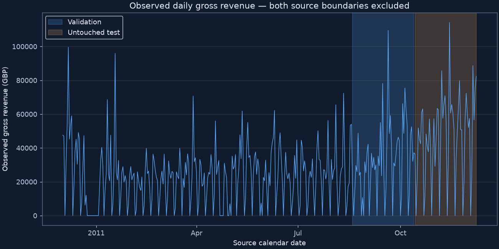
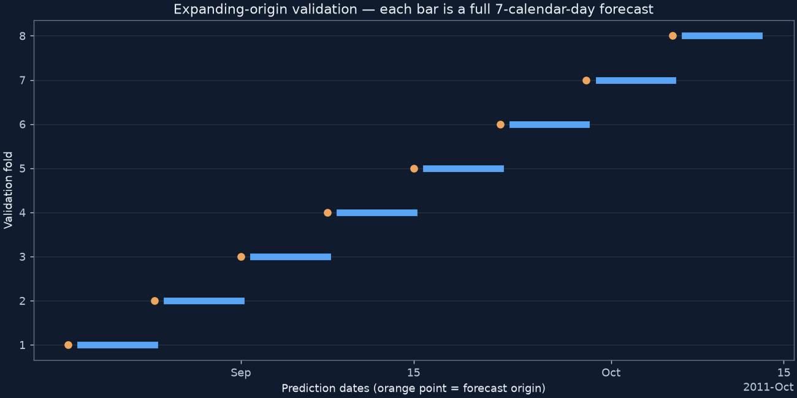
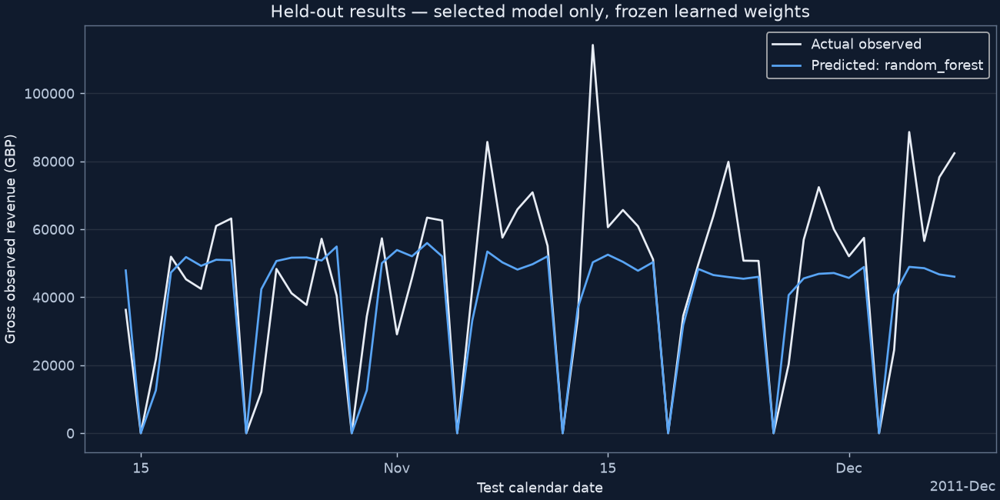
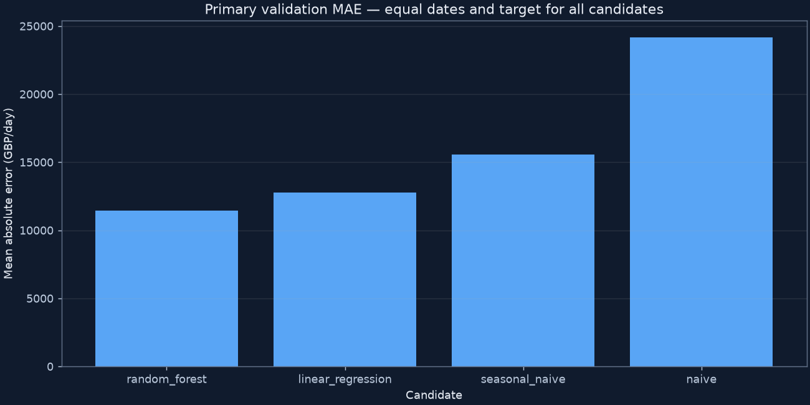
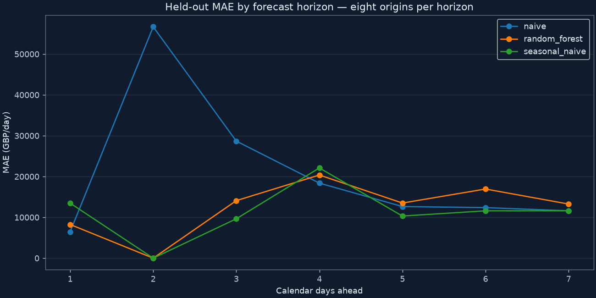
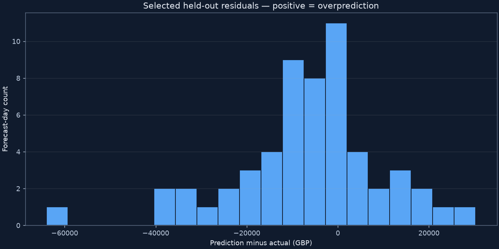
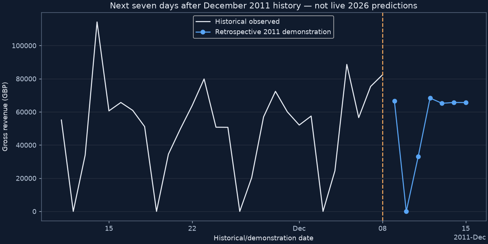

# Phase 3 measured forecasting experiment

## Target and frozen experiment

Daily gross eligible completed-sales GBP, including eligible charges, under unchanged
Phase 1/2 rules. No cancellation netting or valid-outlier deletion. Dates without
records carry zero observed revenue, not a zero-demand assertion. Both source boundary
days are excluded. Modeling range: 2010-12-02 to
2011-12-08. Full source total reconciles to Phase 2 daily SQL;
excluded boundary revenue is £259,677.77.

Initial training: 2010-12-02–
2011-08-18.
Validation: 2011-08-19–2011-10-13
(eight expanding weekly origins). Held-out test:
2011-10-14–2011-12-08 (eight origins).
Splits depend only on dates/length; primary policy, features, hyperparameters, seed,
and selection rule are fixed in the committed experiment. The code selects using
validation before computing test metrics. This verifies the current execution order;
it does not independently establish that earlier manual choices were uninfluenced
by previously viewed test results. The selection file is overwritten on reruns,
so it is not an immutable historical experiment record.

The full seven-calendar-day horizon is recursive: unknown future lag/rolling inputs
use earlier predictions. Known date predictors use no transaction counts, activity
flags, future customers, or future actual revenue. Numeric scaling and weekday
encoding are fitted within each training window. Negative predictions clip to zero
under the same declared policy in evaluation and deployment.

## Primary validation comparison

| experiment | model | mae_gbp | rmse_gbp | wape_pct | bias_gbp | observations |
| --- | --- | --- | --- | --- | --- | --- |
| primary | linear_regression | 12,792.97 | 18,258.31 | 39.57 | -5,324.39 | 56 |
| primary | naive | 24,181.77 | 30,305.71 | 74.80 | 16,260.74 | 56 |
| primary | random_forest | 11,431.53 | 17,764.13 | 35.36 | -4,906.08 | 56 |
| primary | seasonal_naive | 15,580.52 | 21,661.32 | 48.19 | -967.72 | 56 |

Selected **random_forest** by lowest primary validation MAE
**£11,431.53**, with deterministic model-name tie breaking.
Candidate ranking does not use sensitivity outcomes or held-out scores. A baseline
win is reported without forcing a machine learning model into deployment.

## Held-out comparison

| experiment | model | mae_gbp | rmse_gbp | wape_pct | bias_gbp | observations |
| --- | --- | --- | --- | --- | --- | --- |
| heldout_primary | naive | 20,978.67 | 28,049.45 | 45.33 | 10,402.73 | 56 |
| heldout_primary | random_forest | 12,344.71 | 17,396.90 | 26.68 | -6,379.57 | 56 |
| heldout_primary | seasonal_naive | 11,250.17 | 16,218.79 | 24.31 | -2,658.58 | 56 |

Only the selected candidate and required naive/weekly baselines are evaluated here.
Learned weights train through 2011-10-13 and stay frozen
for test. Historical context advances between completed forecast blocks, reflecting
weekly operation. There is no weight refit on test targets. Selected test MAE is
£12,344.71; RMSE £17,396.90; WAPE
26.68%. These results are descriptive evidence on one short
held-out period, not statistical proof of broad superiority.

MAE/RMSE are GBP per forecast-day. RMSE weights large misses more strongly.
WAPE = 100 × sum absolute error / sum absolute actual GBP across the scored rows;
it is undefined for all-zero actuals. Zero daily values do not cause MAPE-style divisions.
Horizon and fold results are in the accompanying CSV files.

The lowest held-out MAE belongs to **seasonal_naive** at
**£11,250.17**. This does not revise the validation selection.
seasonal_naive beats validation-selected random_forest on test. The selection is not revised after viewing test scores; no general machine-learning superiority claim is supported.

## Diagnostics

Selected validation fold MAE ranges from £6,772.46 to
£20,042.77. Test mean prediction-minus-actual bias is
£-6,379.57. Positive means overprediction; negative means
underprediction. Error distributions and horizons do not support claims about
normality, causal weekdays, or stable annual seasonality.

Development-only autocorrelations (no test-based feature selection):
{'1': 0.3498477651131965, '7': 0.598464302760094, '14': 0.44454324770734754, '28': 0.4880124462931671}.
Undefined autocorrelations are stored as JSON null: a constant series (zero or
positive) has no variance, so correlation cannot be estimated. Null does not mean
zero correlation or evidence of no temporal dependence; insufficient varying
paired observations can also make an autocorrelation undefined.
Lag correlations are descriptive and confounded by trend, weekday schedule and extremes;
weekly structure should be judged alongside actual seasonal-naive performance.

Largest selected held-out misses:

| date | forecast_origin | horizon | actual_gbp | prediction_gbp | absolute_error |
| --- | --- | --- | --- | --- | --- |
| 2011-11-14 00:00:00 | 2011-11-10 00:00:00 | 4 | 114,237.40 | 50,286.40 | 63,951.00 |
| 2011-12-05 00:00:00 | 2011-12-01 00:00:00 | 4 | 88,620.84 | 48,931.97 | 39,688.87 |
| 2011-12-08 00:00:00 | 2011-12-01 00:00:00 | 7 | 82,371.55 | 46,050.46 | 36,321.09 |
| 2011-11-23 00:00:00 | 2011-11-17 00:00:00 | 6 | 79,847.00 | 45,941.30 | 33,905.70 |
| 2011-11-07 00:00:00 | 2011-11-03 00:00:00 | 4 | 85,705.30 | 53,447.41 | 32,257.89 |

## Controlled sensitivity experiments — validation only

| experiment | model | mae_gbp | rmse_gbp | wape_pct | bias_gbp | observations |
| --- | --- | --- | --- | --- | --- | --- |
| calendar_training_schedule | linear_regression | 12,371.76 | 18,373.73 | 38.27 | -5,921.76 | 56 |
| calendar_training_schedule | naive | 17,240.26 | 23,190.05 | 53.33 | 9,319.22 | 56 |
| calendar_training_schedule | random_forest | 11,716.15 | 17,768.73 | 36.24 | -4,713.56 | 56 |
| calendar_training_schedule | seasonal_naive | 15,580.52 | 21,661.32 | 48.19 | -967.72 | 56 |
| evaluation_below_initial_training_p99 | linear_regression | 10,527.77 | 13,624.88 | 36.06 | -2,636.44 | 53 |
| evaluation_below_initial_training_p99 | naive | 23,444.60 | 29,775.16 | 80.31 | 19,287.11 | 53 |
| evaluation_below_initial_training_p99 | random_forest | 9,040.34 | 12,688.67 | 30.97 | -2,145.52 | 53 |
| evaluation_below_initial_training_p99 | seasonal_naive | 13,871.00 | 19,273.39 | 47.51 | 1,568.94 | 53 |
| excluding_named_charges | linear_regression | 12,616.08 | 18,017.50 | 39.88 | -5,045.29 | 56 |
| excluding_named_charges | naive | 24,060.65 | 30,029.79 | 76.05 | 16,336.41 | 56 |
| excluding_named_charges | random_forest | 11,346.99 | 17,624.83 | 35.87 | -4,558.32 | 56 |
| excluding_named_charges | seasonal_naive | 15,315.57 | 21,492.00 | 48.41 | -900.85 | 56 |

Calendar alternative: weekdays [5] (Monday=0)
have at least eight initial-training occurrences and no ledger records; those rules
are frozen before validation. Exclude those weekdays from regression training and
forecast zero on their scheduled dates, without examining each future day's activity.
Other gaps remain zero observed revenue. Same seven calendar dates are scored.

Named-charge alternative: exclude exactly DOT, POST, AMAZONFEE, BANK CHARGES.
M (Manual) remains included because its merchandise/adjustment meaning is ambiguous.
This is a distinct revenue target; its errors cannot be called improvements on the
primary gross target. Other ambiguous codes remain included. No sensitivity changes
the primary selection rule.

Extreme influence uses initial-training p99 £71,392.92 to
describe validation error concentration and show below-threshold evaluation only.
No training targets are winsorized or removed, and no held-out threshold is optimized.

| model | threshold_gbp | extreme_days | extreme_squared_error_share_pct |
| --- | --- | --- | --- |
| linear_regression | 71,392.92 | 3 | 47.30 |
| naive | 71,392.92 | 3 | 8.64 |
| random_forest | 71,392.92 | 3 | 51.71 |
| seasonal_naive | 71,392.92 | 3 | 25.07 |

## Persistence and retrospective inference

The selected model is refitted through 2011-12-08 only
AFTER held-out evaluation, for demonstration deployment. This different final refit
is not assigned the pretest model's test score as its own unbiased evaluation.
Version 3.0.0 metadata distinguishes the pretest evaluation cutoff from deployment
cutoff, and records features, seed, policies, metrics, dependencies and provenance.
Model/context/metadata live in ignored data/models with checksum manifest. Load only
trusted local artifacts; hashes do not authenticate an untrusted pickle.

| date | horizon | prediction_gbp | model | training_cutoff |
| --- | --- | --- | --- | --- |
| 2011-12-09 00:00:00 | 1 | 66,565.62 | random_forest | 2011-12-08 00:00:00 |
| 2011-12-10 00:00:00 | 2 | 0.00 | random_forest | 2011-12-08 00:00:00 |
| 2011-12-11 00:00:00 | 3 | 32,980.28 | random_forest | 2011-12-08 00:00:00 |
| 2011-12-12 00:00:00 | 4 | 68,354.81 | random_forest | 2011-12-08 00:00:00 |
| 2011-12-13 00:00:00 | 5 | 65,180.14 | random_forest | 2011-12-08 00:00:00 |
| 2011-12-14 00:00:00 | 6 | 65,684.03 | random_forest | 2011-12-08 00:00:00 |
| 2011-12-15 00:00:00 | 7 | 65,637.92 | random_forest | 2011-12-08 00:00:00 |

These are **retrospective demonstrations for December 2011**, not 2026 forecasts.
The original excluded partial-day record is not used as a future predictor or as a
complete actual to judge the demonstration. No prediction intervals are claimed.

## Figures and interpretations

Interpretation: Missing dates are zero observed activity, not proven zero demand. Windows are chronological; both source boundary days are excluded.

Interpretation: Each origin fits earlier history and predicts a whole week. Actuals within the predicted week are never fed into its predictions.

Interpretation: Selected weights are fixed before test. Later origins may use earlier test dates as context, never their own future window.

Interpretation: MAE compares the same 56 validation forecast-days. Lower means smaller absolute errors; complexity does not determine the ranking.

Interpretation: Eight observations per horizon are a small sample. Errors need not increase monotonically: each lead targets a different weekday.

Interpretation: Positive residuals overpredict. Large negative residuals can reflect spikes; the histogram does not establish independent/normal errors.

Interpretation: Forecasts refer to December 2011 after modeled history. No future transactions are used; no current-business prediction is claimed.

## Reproduction and limitations

`quantiva forecast-prepare`, `quantiva forecast-train`, `quantiva forecast-compare`,
`quantiva forecast`, `quantiva forecast-verify`; see README and phase_3_methodology.md.
Training reruns reproduce this frozen experiment, not a new test-guided tuning loop.
The source is one retailer over about one year, including wholesale spikes, charges,
holiday gaps and missing Saturdays. Eight origins per split/horizon provide limited
stability evidence. Direct horizon models or richer calendars are future options,
not assumed improvements. A 30-day model needs separate evaluation; no claim is made.
