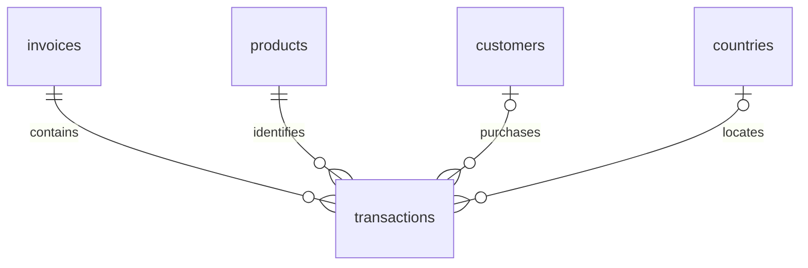

# Phase 2 technical methodology

## Schema and traceability

SQLite is an atomic, rebuildable projection of the verified Phase 1 ledger. No
cleaning policies changed. Quarantined/duplicate rows remain in their Parquet audit.

| Table | Key | Contents |
| --- | --- | --- |
| transactions | source_row | One cleaned Excel line; invoice/product FKs; nullable customer/country FKs; original timestamp, description, signed quantity and classification |
| invoices | invoice_no | Unique source invoice code and cancellation flag |
| products | stock_code | Most recent nonmissing display label; original names remain on lines |
| customers | customer_id | Known ledger customers, including cancellation-only customers |
| countries | country | Source geographic labels; absent geography remains NULL |
| dataset_metadata | key | Schema/policy versions, input hashes, row count |

The ledger has 43 invoices with multiple timestamps and 647 codes with multiple
descriptions. No invoice has multiple known customers or countries, but the schema
preserves these at line grain rather than inventing a header constraint or filling
missing identifiers. Latest known product names are selected by timestamp/source row;
they are labels rather than a curated merchandise catalogue or historical lookup.

Foreign keys are enabled on every connection, as described in
[SQLAlchemy's SQLite documentation](https://docs.sqlalchemy.org/en/20/dialects/sqlite.html#foreign-key-support).
Constraints enforce unique source rows, nonzero integer quantities, nonnegative
prices, exact line multiplication, and valid classification/value combinations.
Six indexes cover date, invoice, customer, product, country, and type/date queries.
Money uses integer £0.0001 units; all observed prices fit that precision. Unsupported
precision is rejected, not silently rounded. Missing customer IDs remain SQL NULL.

Before import, every Phase 1 output checksum and the raw workbook hash are verified.
A temporary sibling database is populated in a transaction, checked for counts,
foreign keys, and SQLite integrity, then atomically replaces the target. It never
appends. Failed rebuilds preserve the prior database. Close Windows consumers and
run only one prepare/rebuild at a time. This suits a finite local dataset; continuous
ingestion would require batch identity and transactional upserts.

Rebuild repeatability compares a digest of sorted schema definitions and every row
ordered by primary key. SQLite file-byte hashes can vary across processes because
index creation order changes internal page layout; that is not a data discrepancy.

## Measurement and independent reconciliation

[KPI definitions](kpi_specification.md) centralize scope, formulas, denominators, and
grain. SQL's completed-sales view uses Phase 1 classification and invoice cancellation
status; pandas selects the validated eligibility flag. Import validates agreement.
There is no independent reinterpretation of the cleaning policy in notebooks.

SQL sums quantity × fixed-point prices stored in SQLite; pandas independently sums
original cleaned float line amounts from Parquet. COUNT DISTINCT and nunique separately
count invoices. Known-customer revenue excludes unknown IDs from both numerator and
denominator. Repeat behavior means at least two distinct eligible invoices within
the observation period; it is not retention or lifetime loyalty.

Checks compare scalars plus every monthly/country/selling-product revenue group.
Missing keys fail even if zero-valued. Counts match exactly; money/ratios use an
absolute tolerance of 0.000001 and no relative tolerance. Undefined ratios match
only other undefined ratios. Hand-calculated fixtures constrain expected business
results, and tampering tests prove discrepancies fail rather than being ignored.

Gross revenue includes charges/postage/manual codes. It is not profit or settled
payment revenue. Signed cancellations are separate; gross plus cancellation movements
is a sensitivity diagnostic, not accounting net revenue without matched original
sales, sale dates, and adjustment rules.

## Statistical analysis

Line amounts, invoice values, known-customer spending, and daily revenue are summarized
separately. Sample variance/std use ddof=1; variance is squared GBP, std is GBP spread,
not predictive uncertainty. Median, quartiles, percentiles, IQR, and skewness describe
heavy tails alongside means. Tukey fences flag unusual observations, not errors.
Means at/below the 99th percentile demonstrate influence without replacing KPIs.

Pearson correlations measure linear associations at matched grains. Pearson on
average ranks equals Spearman rank correlation and reduces sensitivity to magnitude
extremes. Units/value and frequency/spending have mechanical arithmetic relationships,
so causal conclusions are unwarranted. No gratuitous inferential tests or clustering
are added. pandas suffices; SciPy/statsmodels are not necessary for this scope.

Histograms explicitly transform the horizontal scale to log10(1 + GBP), retaining
all positive observations. Other charts use original monetary units. Matplotlib
creates eight PNG charts; Plotly creates self-contained interactive daily HTML.
Interpretations accompany every major chart. Visual inspection checked readable axes,
partial coverage markers, and honest skew handling.

## Coverage, quality, and sensitivity

Daily records span all source calendar dates and flag missing-record dates. Zeros
mean zero recorded revenue, not proven zero demand. Daily statistics distinguish all
calendar dates from interior dates with activity. Weekday averages use all interior
calendar dates and expose calendar/observed denominators in notebooks.

Monthly completeness means the source date span covers that month, not guaranteed
capture on every trading day. Growth compares only adjacent complete months with a
positive previous total. December 2011 and the last midday observation are partial.
December 2010's Christmas gap requires investigation even though the source span
does not truncate that month. Missing Saturdays suggest a schedule but do not prove it.

Duplicate sensitivity reinstates eligible exact duplicate rows in a separate analytical
comparison of revenue, invoices, AOV, and units. The stored ledger stays unchanged.
Eligibility reuses the full Phase 1 cleaner on audit keys, then restores original
multiplicities; invalid positive duplicates are never reinstated merely for having
positive quantities/prices. A regression test covers missing invoices and fractional units.
Negative-price bad-debt records remain quarantined. Negative noncancelled zero-price
rows remain stock-adjustment candidates, not confirmed returns. Extreme positive/
negative quantities are shown without asserting verified matching. A stock-code
syntax heuristic creates an investigation list and never silently excludes records.

## Reproducibility and future decisions

README workflow: locked install → download/prepare → verify_data → database →
analyze → verify_analytics → execute_notebooks. nbclient starts a new kernel per
notebook using a temporary kernelspec bound to the calling Python, clears outputs,
verifies the interpreter, and saves successful executions. See
[nbclient execution documentation](https://nbclient.readthedocs.io/en/latest/client.html).
No global kernel is registered. Final verification also uses a fresh Python 3.11
environment installed from the lock; data is reused by checksum, not redownloaded.

Before Phase 3, resolve missing-date treatment and exclude/flag the final partial day.
Investigate whether target scope should include charges and exceptionally reversed
bulk orders. Start with naive and weekly baselines, expanding chronological folds,
and 7-day evaluation horizons. Lag/rolling features must use prior values only;
multi-step validation must simulate inference. Linear regression/random forest are
later comparisons, not presumed improvements. Short history and unknown returns
limit reliability. These are recommendations only: Phase 3 has not begun.
